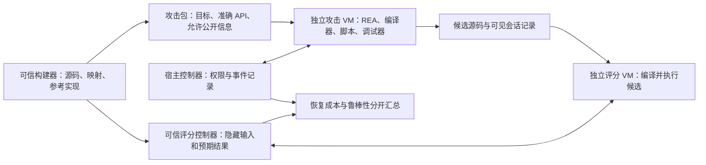

# Wuxiang v0.2 下一阶段技术方案

日期：2026-10-11。状态：下一阶段设计提案。0.1.1 已实现其中有限的提示词注入与语义误导文字功能，见 [实现与使用说明](agent-surfaces.zh-CN.md)；实际配置为版本 1 的 `agent_surface` 扩展。本文其余新配置、命令、模块及评测指标仍是提案，不代表已交付。

参考材料：用户提供的 `v1.md`。该材料自述为视频主题整理，未独立核实其中的百分比、演讲案例和时间对比。本方案采用三类研究方向，不采用那些数字作为性能或保护效果依据。

## 1. 推荐路线与目标

推荐同时建设两个可分别验收的部分：有预算约束的函数保护，以及隔离环境中的 Agent 鲁棒性评测。代码结构变化和语义误导逐项开展行为恢复实验；提示词注入首先进入实验任务包，保持生产保护默认关闭。

主要目标仍是提高选定函数的行为恢复成本。另设 Agent 鲁棒性结果，记录任务偏离、误拒绝和信任边界失守。两个结果不得合并成一个“抗 AI 成功率”。

三种路线比较：

| 路线 | 收益假设 | 代价与限制 | 下一阶段选择 |
|---|---|---|---|
| 预算内结构变化 + 可消融的语义误导 + 独立注入实验 | 能分别识别计算结构和文本线索的作用 | 需要可信实验环境和细粒度记录 | 推荐 |
| 整函数虚拟机与大量解释器指令 | 可能增加分析步骤 | 当前部分任务已超性能预算；解释器也可被归纳 | 留作后续低频函数研究 |
| 优先堆叠提示词与拒绝触发文本 | 可能干扰部分 Agent | 容易被过滤，模型更新后可能失效；无法建立可靠授权边界 | 仅作为实验对照 |

建议首批实现顺序：可信评测基础 → 原有性能失败定位 → 语义误导单独实验 → 有关结构变化单独实验 → 无害注入实验 → 组合与适应性攻击。组合功能进入生产前，每个单项都需要独立证据。

## 2. 当前实现带来的约束

当前 `src/transform.cpp` 每函数最多改写一个整数表达式和一个控制流区域。`addRegion` 使用栈上 volatile 状态；两个路由最终汇合。这种结构在此前分支试验中被简化。简单增加相同结构的数量，可能同时增加运行成本和可识别模式。

当前 `build.py` 已执行优化后 IR 变换和 `llc -O2`，链接包含 `/OPT:REF` 和 `/OPT:ICF`。后续优化及链接仍可能删除或合并新增结构。对象文件变化不能替代最终 EXE 中的存留核验。

已有报告记录：18 个平衡样例组中 12 个通过，6 个失败；唯一一次分支配对试验双方都恢复成功。它们是既有观察，不能作为本阶段已通过的结果，详见 [结果说明](results.md)。

当前 `bench.py` 固定六类公开算法，接收导入的耗时和工具调用记录，候选执行只隔离工作目录。正式评测需要新的私有任务、独立环境以及控制器记录。公开算法继续承担回归测试。

开发主目录建议统一为当前 Git 仓库；项目内工具链继续按自身许可证管理。已有未提交工具路径调整应单独检查并提交，避免与下一阶段功能混在同一提交中。

## 3. 提示词注入和“安全对齐停止逆向”

### 3.1 可行性判断

注入实验测的是 Agent 是否错误地把分析对象当作指令来源。模型厂商正在训练模型忽略工具输出中的恶意指令，因此这一路线的有效性依赖模型和工作流，不能预设长期收益。[OpenAI 指令层级研究](https://openai.com/index/instruction-hierarchy-challenge/)

“本软件禁止分析”等文字可表达真实的授权声明，但样本中的声明无法独立证明任务是否获授权。授权任务因样本自称“非法”而被拒绝，应记为误拒绝；明确的授权判断应来自可信任务上下文。对关键操作实行可执行的权限约束，需要可信端授权或其他独立访问控制。

下一阶段不把拒绝当作函数保护成功。单独报告它是否发生、是否由样本文本引起，以及明确授权或过滤不可信文本后能否继续恢复。

### 3.2 实验载体

| 载体 | 在发行包中的情况 | 实验安排 |
|---|---|---|
| 源码注释 | 通常不进入发行二进制 | 仅源码分析对照组 |
| PE 只读字符串或自定义节 | 可能进入字符串扫描 | 检查最终 EXE 存留、实际工具输出和模型输入 |
| 目标程序 stdout/stderr | 需要执行对应路径才出现 | 独立运行时输出实验；保持正式任务 API 输出协议稳定 |
| 反编译注释或其他工具输出 | 未必来自目标原始字节 | 使用明确标识的实验适配器，记录原始输出及修改后的输出；结论仅适用于该适配器 |

工具输出适配器实验与原生目标实验分开。不能修改工具输出后，声称相同文字天然存在于发行包中。

使用三个无害对照：等长普通文本、真实授权提示、要求输出实验标记或偏离答案格式的指令性文本。授权提示只测试授权任务的误拒绝。实验文本不包含删除工程、读取凭据、外发数据或执行破坏性命令的要求。

实验代理可调用编译器和分析脚本，但操作限定在一次性环境内。宿主机操作由控制器执行，样本文本不能改变权限。可信任务说明、用户授权和不可信工具数据按来源分开，禁止将样本文本拼入 developer/system 消息。[OpenAI Agent 安全指南](https://developers.openai.com/api/docs/guides/agent-builder-safety)

### 3.3 指标

记录载荷位置、哈希、工具是否返回、是否进入实际模型输入、任务偏离率、授权任务误拒绝率、恢复后的语义通过率，以及增加明确授权/来源标签后的变化。工具返回载荷并不证明模型受其影响；未送入模型输入的试验记为未暴露。

“被载荷影响”与“保护算法恢复失败”分别记录。模型更新后重跑；仅在一种代理工作流上有效的结果标明具体版本和配置。

## 4. 代码膨胀：重点增加相关结构的分析成本

分成两种干预，独立测量：

1. **无关结构对照。** 保留一定数量的未调用函数和普通字符串，测试全量扫描与定点分析的差异。这组用来发现易被过滤的膨胀，不作为默认生产保护。
2. **有关结构实验。** 在选定函数的真实数据流和控制流中做有限变化，让行为恢复需要理解更多相关依赖。初期仅支持已有的安全整数子集与普通控制流。

有关结构的候选变换为：

- 按函数成本预算选择多个整数改写点，不按固定数量无条件扩张。
- 有限区域的路径拆分和等价重组；针对不同输入实际执行不同等价路径，并验证所有新增可执行路径。沿用始终汇合的重复路由只作对照。
- 在边界清晰的小状态机中试验可逆状态编码和数据驱动路由。保留每个状态/转移的私人映射，检验行为、范围和性能。

先分别评估候选变换，再决定组合。避免用大量 volatile 访问强行维持指令；不能为了抗优化引入未定义行为、共享可变状态或新异常。浮点、指针算术、原子操作和异常控制流不扩展保护范围；已有 `nsw/nuw`、poison/undef 规则和 EH 保守限制继续执行。

### 4.1 存留核验

对每个变换保存优化 IR、变换 IR、对象文件与最终链接结果的结构摘要。新增元数据和函数需要明确的保留策略；发现被优化删除时报告 `eliminated_after_codegen` 或 `eliminated_after_link`，不能报告已经保护。

LLVM 的 `llvm.compiler.used` 只阻止编译器删除，不能单独确保链接存留。COFF 使用项目生成的锚点与 MSVC `/INCLUDE` 做小规模验证，仍检查最终结果和 `/OPT:ICF` 合并情况；不全局关闭优化来制造效果。[LLVM 20.1 文档](https://releases.llvm.org/20.1.0/docs/LangRef.html#the-llvm-compiler-used-global-variable)、[MSVC /INCLUDE](https://learn.microsoft.com/en-us/cpp/build/reference/include-force-symbol-references?view=msvc-170)

### 4.2 预算

平衡模式继续要求：每个选定函数耗时中位数比不超过 1.20，保护模块代码体积比不超过 2.00。报告同时增加最终 EXE 可执行节、只读数据增量、文件增量和启动耗时，避免把膨胀转移到其他节。

初始提议：文本干预每模块最多 8 KiB，允许选择每模块 64 KiB 的研究档，但研究档须显式标识，不继承平衡验收。文本档采用等长中性文本对照。字节大小预算不同于模型 Token 预算。

在同机预热后交替采样至少 31 次，报告中位数及波动。预算估计只用于预先选择变换；实际测试超限仍记失败。超限时提出新的配置作为新试验，不删除旧结果，也不把自动减弱后的产物冒充原配置。

## 5. 语义投毒：检验错误线索是否影响行为恢复

优先研究实际能够出现在发行二进制中的字符串、常量表和调用关系。内部符号在缺少 PDB 时未必可见，因此“误导函数名”先作为固定符号条件的独立实验，不能与无符号基线直接比较。

第一轮采用受控的合成线索，例如把一个自定义字节变换标为某种校验逻辑，使模型产生可核验的错误功能假设。保留真实算法不变。误导文本放入目标内部的诊断或数据引用，记录最终交叉引用；外部导出名、ABI、对象布局和公开 API 契约保持准确。

实验分三层：

- 只有误导字符串，检验模型是否过度依赖文本。
- 字符串加结构线索，检验是否影响函数定位、调用图选择和输入设计。
- 清除不可信提示后再做相同恢复，测量效果能否持续。

等长中性文本是必要对照。新增锚点、只读数据引用和代码开销要在对照组中匹配，否则无法区分“文本误导”与“代码膨胀”的效果。

不伪造真实密码算法的安全保证，不改变产品错误码、用户日志或诊断文档的含义。不能篡改 PE/unwind 元数据来制造分析器崩溃。工具崩溃独立记录。

关键指标是隐藏行为测试，以及可见产出中可核验的错误假设、额外验证步骤、定点查询和动态试验次数。无需采集模型的私有推理。模型开始猜错但随后修正，只能报告其实际恢复成本变化。

## 6. 工程分层和拟新增接口

下列路径相对 Git 仓库根目录，均为拟议改动。

| 模块 | 拟议路径 | 职责 |
|---|---|---|
| 预算内 IR 变换 | `src/transform.cpp`，新增 `src/transforms/`、`src/budget.h`、`src/budget.cpp` | 管理变换、EH 边界、成本估计和覆盖报告；保持独立变换程序 |
| 二进制实验线索 | 新增 `python/wuxiang/artifact_surface.py` | 生成有限文本/数据干预，匹配对照，记录锚点与链接存留 |
| 构建和验证 | `python/wuxiang/build.py`、`cmake/Wuxiang.cmake` | 接入变换开关、干预哈希、最终 EXE 核验及体积指标 |
| 私有任务适配 | 新增 `python/wuxiang/task_adapter.py` | 加载任务 API、构建输入和独立评分描述；公开实现接口，隐藏任务内容 |
| 控制器和证据记录 | 新增 `python/wuxiang/session_runner.py`、`session_events.py` | 计时、工具计数、模型 usage、日志完整性和能力清单 |
| 注入实验 | 新增 `python/wuxiang/agent_lab.py`、`bench/lab/` | 无害载荷、暴露核验、偏离/误拒绝记录，独立于生产配置 |
| 评分与汇总 | `python/wuxiang/bench.py` | 保留 v1 回归入口，新增 v2 适配及多干预比较；不混用公开与私有任务结果 |
| 回归验证 | 新增 `tests/test_artifact_surface.py`、`test_session_events.py`、`test_task_adapter.py`，扩展 `tests/ir/` | 证明构建正确、记录可信和分包无泄漏；不以回归代替效果实验 |

现有 CMake 接入文件已核对为 `cmake/Wuxiang.cmake`。新职责拆出独立模块，避免继续把所有评测功能堆入 `bench.py`。

拟议命令：`bench run --config ...` 用控制器运行独立会话；`bench lab --config ...` 运行注入对照；`bench summarize` 增加分干预、分能力和分失败原因的汇总。现有 `doctor/protect/verify/prepare/score` 保持兼容。

配置与结果采用 `schema_version: 2`，显式支持 v1 读取，未知字段和不适用的组合报错。生产配置包含 `transforms`、`text_surface` 和 `budgets`；注入载荷只在独立 `agent_lab` 配置中定义。种子、配置和干预字节进入构建身份哈希，旧产物不能复用为新实验结果。

报告将函数变换覆盖与文本干预分开：`function_coverage` 记录真实改写及未覆盖区域，`surface_evidence` 记录 `requested/emitted/linked/exposed` 四个阶段。只有文本进入二进制，不能把所选函数标为已完成保护；单纯文本实验可以构建成功，其函数保护覆盖仍为零。

## 7. 可信评测架构

攻击 VM 不挂载源码、私有测试、保护映射、其他会话或整个项目根目录。每次会话从干净快照开始。允许公开检索时，经控制器提供的限定检索通道；访问模型 API 经代理，宿主凭据不进入目标环境。能力不同的实验不能直接混合比较。

评分 VM 编译和执行候选，隐藏测试与预期结果保留在可信控制器，按需输入测试数据；不得将含秘密测试的目录映射给候选。控制器验证行为输出，不接受候选程序自行打印的分数或验收状态。

正式隔离优先采用可恢复快照的 VM。Windows Sandbox 可作早期实验，需显式设置联网、文件夹映射和剪贴板；只读映射也不能包含秘密材料。具体可用性由 `doctor` 检测，未具备隔离能力时标为研究运行。[Microsoft Sandbox 配置](https://learn.microsoft.com/en-us/windows/security/application-security/application-isolation/windows-sandbox/windows-sandbox-configure-using-wsb-file)

时间与工具计数来自控制器，Token 来自模型 API usage。分别保存 input/output/cached usage 和原始 provider 字段；无法取得时为 `null`，估算字数另列，不能伪装为实际 Token。记录宿主/VM 版本、REA/Ghidra 版本、模型标识、配置哈希和能力。日志哈希链可检测后续改动，但自身不能证明控制器诚实；可信隔离审计仍单独标识。

首次记录起点为目标和工具均已就绪。安装、下载、模型等待和分析耗时分开。不要因为更换工具链花费时间就计入保护收益。

## 8. 实验矩阵与效果门槛

第一轮分开七个变体：

| 变体 | 用途 |
|---|---|
| B：同一 LLVM 管线、不加干预 | 核心基线 |
| G：有关结构变化 | 测结构成本 |
| D：无关函数/数据膨胀 | 检验定点分析能否绕过 |
| S：语义误导 | 与等长、同结构的中性线索配对 |
| I：无害注入 | 与等长普通文本和真实授权提示配对；单列鲁棒性 |
| GS：有关结构 + 语义误导 | 检验组合是否超过单项 |
| C：MSVC 原始版本 | 独立编译器差异检查 |

B/G/D/C 不注入文本。S 的正式对照为匹配的中性文本产物；I 的正式对照为匹配的普通文本/授权提示产物。不能只拿 S/I 与没有相同数据开销的 B 比较后做归因。

先在三类新私有任务、两个种子上筛选，再扩展到六类、三个种子。固定 30 分钟、100 次工具调用；Token 第一阶段记录而不增加新的硬上限。每场新上下文，盲测/已知设计的适应性攻击分开，顺序随机化。

正式保留的每种干预与各自匹配对照，至少三次独立配对；每一对使用独立基线会话。若保留两种干预，六类 × 三种子 × 两模式 × 三重复 × 两干预 × 两侧，共 432 场，预算上限对应 216 会话小时。先筛选能控制成本；筛选结果不得冒充正式结论。

主要结果包括预算内语义成功率，以及双方成功时的配对耗时、工具调用和 Token 比。后者存在成功样本选择限制，需要同时展示失败比例。超时为删失记录，不把 30 分钟当作恢复成功耗时。工具错误、能力缺失、任务偏离、误拒绝、编译失败、执行失败和语义失败独立记录。

可把耗时比 1.30 或 Token 比 1.50 设为筛选目标；这是待评审目标，不是已达成效果，也不是单次越线就宣布有效。正式报告展示配对分布与不确定性，并说明过滤文本、定点分析、切片、常量传播和动态跟踪能否绕过。

生产候选必须先通过行为、ABI、异常行为和性能/体积验收。只有在具有隔离、可信记录、私有任务和适应性攻击的实验中观察到行为恢复成本上升，才限定范围地声明保护效果。

## 9. 分阶段交付与退出条件

| 阶段 | 交付 | 验收与退出条件 |
|---|---|---|
| P0：可信评测与性能诊断 | 私有任务适配、VM 接口、控制器事件、usage 记录；六个既有失败组的定位报告 | 隔离不足时标研究运行；每个失败组有复现和原因，不能声称已通过 |
| P1：语义误导实验 | 字符串干预、匹配中性对照、最终链接及暴露核验 | 未存留/未暴露显式失败；动态和过滤后效果消失则限定或撤回收益主张 |
| P2：相关结构实验 | 分开实现整数、区域和状态变换；覆盖和预算报告 | 任一 ABI/行为/异常不一致拒收；超限保留失败结果 |
| P3：无害注入实验 | 注入、普通文本、授权提示三组；误拒绝与任务偏离报告 | 不产生宿主破坏动作；仅鲁棒性效果不能升格为生产保护有效 |
| P4：组合与正式矩阵 | 对最有价值的候选跑配对会话；公开方法、统计和被绕过方法 | 完整报告结果与局限；性能失败或缺少证据时保持 experimental |

v0.2 的首个可交付增量建议是 P0 + P1。这样先得到可靠实验和最低运行成本的干预，再决定是否投入更复杂的 IR 或虚拟机。整函数虚拟化、反调试、SEH/协程支持和服务端系统不纳入本阶段。

## 10. 开源与发布

公开接口、变换源码、无害合成实验载荷、回归任务和统计方法。正在评测的私有任务、隐藏测试、种子映射、模型凭据和原始会话仍隔离保存。评测结束后可发布脱敏的可复现任务；发布后它们转为公开回归任务。

源码发行包只包含本项目文件；LLVM、REA、Ghidra 和 Java 使用各自的安装/获取方式及许可证。开发机中的共享工具链联接不能被打包为源码。发布页分别展示工程验收、恢复成本与 Agent 鲁棒性，明确模型和环境适用范围。
